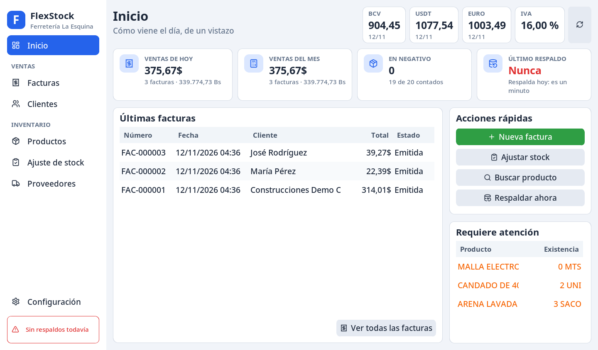
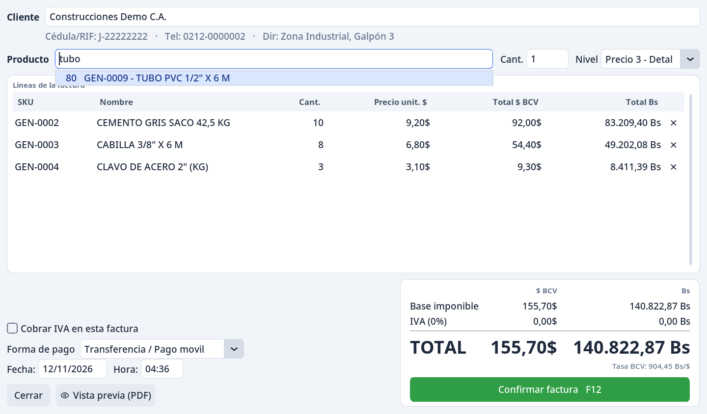
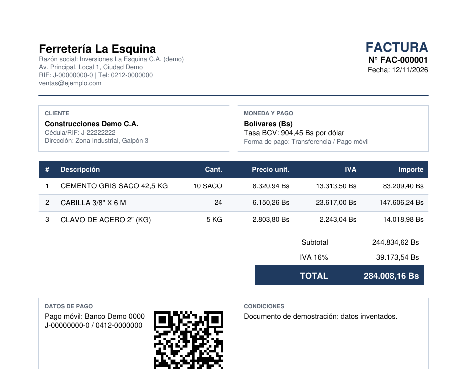
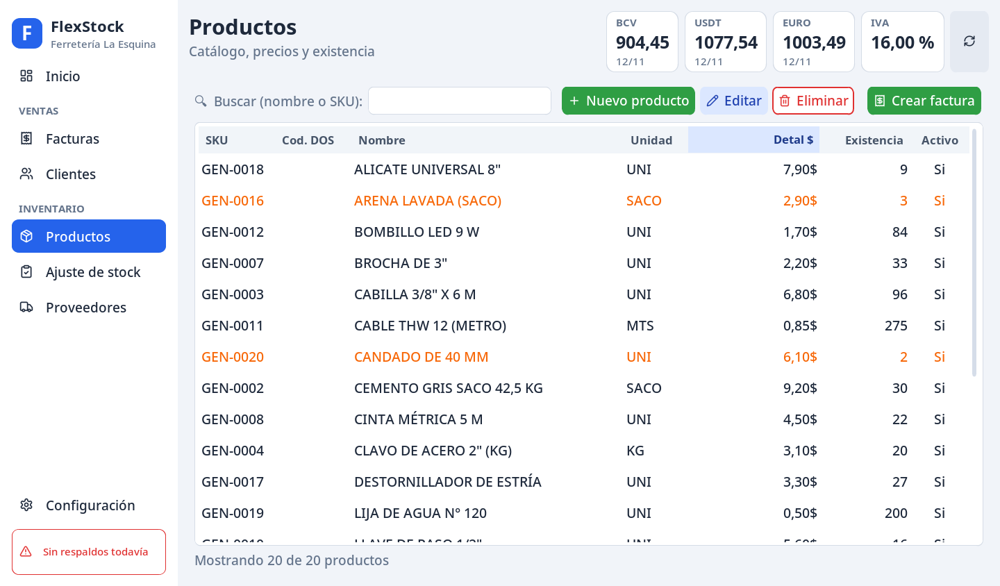

# FlexStock-lite

Inventario y facturación para una ferretería venezolana. Reemplaza a
**Saint 7.51**, un sistema DOS del año 2000, y migra su catálogo de
**1.936 productos**. Está en uso real en el negocio.

**Python 3.13 · CustomTkinter (Tkinter) · SQLite · ReportLab · pytest**
— arquitectura por capas, **+1.300 tests**.



> Las capturas usan una base de demostración con datos inventados.

## El problema

La ferretería trabajaba con un programa DOS de hace 25 años: sin respaldos,
sin PDF y con los precios en una sola moneda. En Venezuela se vende con
precios en **dólares** y se cobra en **bolívares** a la tasa oficial del BCV,
que cambia todos los días. Una factura de ayer reimpresa hoy **no puede**
cambiar de monto. Este sistema resuelve eso, más la migración de datos sucios
del sistema viejo.

## Qué hace

- **Facturación pensada para el mostrador:** se elige el cliente, se escribe
  el producto, Enter, la cantidad, Enter. Todo con teclado (Tab, flechas,
  Enter; F12 confirma). El borrador vive en memoria y confirmarlo es **una
  sola transacción**: factura, líneas, movimientos de stock y caché.
- **Dos monedas:** precios en $, cobro en Bs con la tasa BCV del día
  (se actualiza sola desde internet). La tasa se **congela en cada
  factura** y el PDF sale en bolívares con esa tasa, siempre igual.
- **PDF profesional:** logo, datos fiscales del emisor, IVA opcional y un
  **QR de pago** para pagar escaneándolo con el teléfono.
- **Inventario con historial:** cada entrada, venta, ajuste o anulación es
  un movimiento que no se edita ni se borra. Ajustes de stock con quién
  contó y por qué.
- **Cierre de caja** diario y mensual por forma de pago, en $ y en Bs.
- **Proveedores muchos-a-muchos** con historial de entregas (fecha, costo,
  contacto).
- Respaldos de la base, exportación a CSV/PDF, modo claro/oscuro y tamaño de
  letra de 90 % a 150 %.

| Nueva factura | Factura en PDF (en Bs) |
|---|---|
|  |  |



## Decisiones técnicas

- **Dinero en centavos, nunca `float`.** `0.1 + 0.2 != 0.3` en punto flotante;
  en una factura eso es un céntimo perdido. Dinero en enteros ×100,
  cantidades en enteros ×1000 (se venden 2,5 kg de clavos), y **una sola
  frontera de conversión** (`domain/money.py`).
- **Snapshots en los documentos.** El precio unitario, el IVA y la tasa de
  cambio se copian a la factura al emitirla. Reimprimir una factura vieja da
  exactamente el mismo monto, aunque el precio o la tasa hayan cambiado.
- **Stock append-only.** La verdad del stock es la suma de
  `inventory_movements`; la columna `current_stock` es un caché que solo
  modifica `StockService`, en la misma transacción que su movimiento.
- **Las facturas no se editan ni se borran:** se anulan, y la anulación
  devuelve el stock con movimientos nuevos.
- **Sin N+1.** Los repositorios tienen contratos explícitos (`list_summary`,
  `get`, carga en lote con `WHERE id IN (...)`). Medido con
  `set_trace_callback`: validar el stock de una factura de 20 líneas pasó de
  **60 consultas a 1**, y hay un test que cuenta consultas, no resultados.
- **Migración de datos reales:** tres `.txt` del sistema DOS en CP850, ancho
  fijo y CRLF; unas 700 variantes de nombre de proveedor normalizadas con
  revisión manual por CSV, no adivinadas.

## Arquitectura

Las dependencias apuntan hacia adentro:

```
ui/  ──►  services/  ──►  domain/  ◄──  data/
```

| Capa | Qué tiene | Regla |
|---|---|---|
| `domain/` | Entidades, enums, dinero, conversión a Bs | No importa `sqlite3` ni `tkinter` |
| `data/` | Repositorios y `schema.sql` | Único lugar con SQL |
| `services/` | Reglas que tocan varias entidades (facturar, stock, cierre) | Transacciones atómicas |
| `ui/` | CustomTkinter, envuelto en `ui/kit.py` | Solo habla con `services/` |
| `reports/` | PDF con ReportLab | Solo dibuja, no consulta |
| `importers/` | Migración desde el sistema DOS | |

Que el dominio no conozca la base ni la interfaz es lo que permitiría
llevar la misma lógica a una versión web sin reescribirla.

## Calidad

```bash
pytest -q                      # +1.300 tests: dominio, servicios, PDF y UI
ruff check . && ruff format .
```

Los tests de interfaz abren ventanas Tkinter reales (en un Xvfb que arranca
solo, si está instalado) y
miden la geometría a 100 % y 150 % de letra para que ningún botón quede
fuera de la ventana. **Ningún test espera por reloj:** una fixture corre el
mainloop hasta que se cumple la condición, así no hay tests que fallen a
veces. Otra fixture impide que un test salga a internet.

## Instalación

```bash
python -m venv .venv
source .venv/bin/activate        # Windows: .venv\Scripts\activate
pip install -r requirements-dev.txt   # solo para usar la app: requirements.txt
python app.py
```

Pensado para Windows y Linux (rutas con `pathlib`, archivos con
`encoding` explícito); se desarrolla y prueba en Arch Linux. Tkinter viene con Python en Windows; en Arch:
`sudo pacman -S tk`. La base de datos se crea vacía en
`~/flexstock-lite/` la primera vez y **nunca** entra a Git.

## Estado

En uso en una ferretería familiar desde septiembre de 2026, en una sola PC.
Pendientes con su diseño discutido: notas de crédito, descuentos y una
versión en la nube con varias PC por negocio.

Desarrollado con Claude Code como asistente. Las reglas del proyecto, las
decisiones y los pendientes están en [`CLAUDE.md`](CLAUDE.md).
